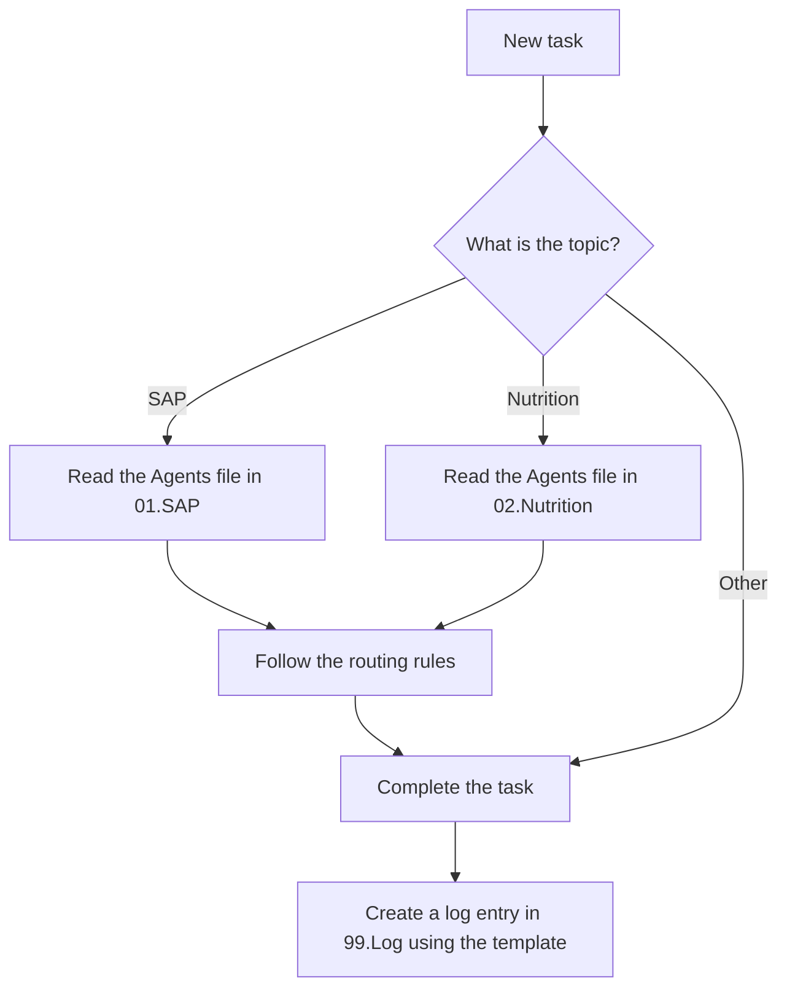

# About Me

## Profile

| Field       | Details                    |
| ----------- | -------------------------- |
| Role        | SAP Technical Consultant   |
| Work model  | Freelance                  |
| Location    | Ho Chi Minh City, Vietnam  |
| Languages   | Vietnamese, English        |

## Summary

I am a freelance SAP Technical Consultant. I design, develop, and support SAP solutions for my clients, from backend development to user interfaces and cloud integration. I prefer answers that are accurate, concise, and ready to use in a real SAP system.

## Core Expertise

- **ABAP:** Classic ABAP, ABAP Objects, reports, function modules, enhancements
- **ABAP RESTful Application Programming Model (RAP):** Behavior definitions, actions, authorization checks
- **Core Data Services (CDS):** Views, associations, annotations, access control
- **OData:** V2 and V4 services
- **SAP Fiori / SAPUI5:** Freestyle apps and Fiori elements
- **SAP BTP:** CAP, approuter, destinations, identity providers
- **Forms:** Adobe Forms
- **Security:** Authorization objects, roles, and authorization checks

## Instructions for the AI Agent

### 1. SAP-Related Tasks

A task is considered SAP-related if it involves any of the following keywords (or similar SAP topics):

`SAP`, `ABAP`, `RAP`, `CDS`, `OData`, `Fiori`, `SAPUI5`, `UI5`, `BTP`, `CAP`, `S/4HANA`, `HANA`, `BAPI`, `RFC`, `IDoc`, `Adobe Forms`, `Smart Forms`, `T-code`, `Transport`, `Authorization`, `PFCG`

When a task is SAP-related, follow these steps:

1. Go to the folder [[01.SAP/Agents|01.SAP]].
2. Open and read the [[01.SAP/Agents|Agents]] file in that folder **before** starting any work.
3. Follow the routing rules in the [[01.SAP/Agents|Agents]] file to decide which skill, knowledge note, or workflow to use.
4. Complete the task according to those rules.

### 2. Nutrition-Related Tasks

A task is considered nutrition-related if any of the following applies:

- The request contains keywords related to nutrition, such as:
  `nutrition`, `calories`, `kcal`, `macros`, `protein`, `carbs`, `fat`, `fiber`, `meal`, `diet`, `food`, `vitamins`, `minerals`, `weight`, `BMI` (or similar nutrition topics).
- I share any information about my meals, food intake, or nutrition.
- I upload an image related to nutrition (for example, a photo of a meal, a food label, or a nutrition facts table).

When a task is nutrition-related, follow these steps:

1. Go to the folder [[02.Nutrition/Agents|02.Nutrition]] immediately.
2. Open and read the [[02.Nutrition/Agents|Agents]] file in that folder **before** starting any work.
3. Follow the routing rules in the [[02.Nutrition/Agents|Agents]] file to decide which specific nutrition workflow to use.
4. Complete the task according to those rules.

### 3. Logging After Each Task

After a task is completed, record the work as follows:

1. Go to the folder [[99.Log/Template|99.Log]].
2. Open the [[99.Log/Template|Template]] file in that folder.
3. Create the log entry by strictly following the [[99.Log/Template|Template]]. Do not change the template's structure, headings, or formatting.
4. Save the log entry in the [[99.Log/Template|99.Log]] folder.

## Workflow Overview

